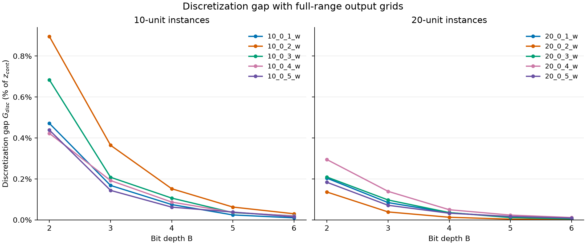

# Task 1: continuous and discretized UC baselines

Generated 2026-11-01T22:36:08.616359+03:00. Base commit: `39b64a31950d826514795f4f9ef115ddfa85964c`.

## Data and preprocessing

All ten committed OR-LIB files were loaded using gzip magic-byte detection. Their UnitCommitment.jl input format version is **0.3**. None has a generator `Type` field; every generator is treated as thermal, with an explicit per-generator audit entry. Each instance has one bus, 24 hourly loads, and 10 or 20 units.

The raw cost form is a convex **piecewise-linear total-cost curve with five breakpoints** per unit. The breakpoints lie on convex quadratics to floating-point precision. We fit `a + b*p + c*p²` by least squares at the original breakpoints, enforcing `c >= 0`, then use those same coefficients in both reference models. The intercept `a` is charged only when on; the first breakpoint cost is not used as a second no-load charge. Linear curves use `c = 0`.

Pmin is rounded up, Pmax down, and aggregate bus demand up to q = 1 MW. All benchmark capacity endpoints were already integral; all 240 hourly demands rounded upward. Original and rounded arrays, per-unit/per-hour coefficients, RMSE, maximum absolute fit errors, raw file SHA-256 hashes, assumptions, and every dropped field (including its value) are in `results/preprocessing.json`. All raw generator parameters are static in these ten files; demand varies hourly. No benchmark unit is marked must-run; the loader/model support hourly must-run flags.

| Instance | Units | Maximum breakpoint fit error ($) | Maximum unit fit RMSE ($) | Dropped-field entries |
|---|---:|---:|---:|---:|
| 10_0_1_w | 10 | 1.455e-11 | 1.177e-11 | 81 |
| 10_0_2_w | 10 | 1.637e-11 | 1.177e-11 | 81 |
| 10_0_3_w | 10 | 1.819e-11 | 1.621e-11 | 81 |
| 10_0_4_w | 10 | 1.819e-11 | 1.271e-11 | 81 |
| 10_0_5_w | 10 | 1.364e-11 | 1.168e-11 | 81 |
| 20_0_1_w | 20 | 1.637e-11 | 1.403e-11 | 161 |
| 20_0_2_w | 20 | 1.637e-11 | 1.327e-11 | 161 |
| 20_0_3_w | 20 | 1.455e-11 | 1.190e-11 | 161 |
| 20_0_4_w | 20 | 1.819e-11 | 1.509e-11 | 161 |
| 20_0_5_w | 20 | 1.455e-11 | 1.162e-11 | 161 |

Dropped fields in every instance: generator `Bus` (network allocation), `Initial power (MW)` (only initial on/off status is retained), `Minimum uptime (h)`, `Minimum downtime (h)`, `Reserve eligibility`, `Startup delays (h)`, `Ramp up limit (MW)`, `Ramp down limit (MW)`, and the complete `Reserves` object. Each raw generator has one startup category; its cost is retained. For inputs with multiple categories, the loader takes the cheapest hourly cost and logs the discarded category structure. Initial-status duration is reduced to its sign; minimum up/down carryover is outside scope. Source and license text are retained as metadata.

## Models and optimality

Both models retain binary commitment, exact startup transitions (including initial status), demand ≥ load, output bounds, and must-run constraints. The continuous model uses SCIP with a convex perspective epigraph `c*p² <= v*u`, exact for binary commitment. The discrete model uses an integer index `k = 0,…,2^B_i−1`, equivalent to all binary-weighted bit patterns, with `k <= (2^B_i−1)*u` and `p = Pmin*u + Δ_i*k`. Convex adjacent-level chord inequalities evaluate the quadratic exactly at every grid point, so SCIP solves an exact MILP for this restricted quadratic model.

For the full discrete runs, SCIP certifies hourly dispatch patterns in increasing production cost. At fixed hourly commitments, dispatch is independent of every other hour. A separate SCIP master selects generated patterns with the original startup costs and initial status. Each hour also has an optimistic unseen-pattern option, priced at a proven lower bound on all patterns not yet generated and allowing arbitrary commitments. This makes the master a relaxation of the entire grid model. Whenever its optimum uses an unseen option, another pattern is generated for that hour. Termination requires a proven-optimal master using only known, feasible patterns: its lower bound then equals a feasible full-model cost and proves global optimality. No bit pattern is removed from the full feasible set. Every pricing solve and master solve uses SCIP and retains its certificate.

Discrete solve time is the sum of all hourly pricing and master SCIP solve times. Build time includes all hourly models and master rebuilds. Component timings, pattern counts, master bounds, and the final empty unseen-option set are in each run JSON. The direct 24-hour grid MILP remains available through `solve(build_model(instance, B))` and is cross-checked against pattern generation and enumeration on small instances.

Every nonzero-width unit uses B bits and `Δ_i = (Pmax_i−Pmin_i)/(2^B−1)`; fixed-output units use zero bits. All rounded bounds and demands are asserted integer. The loader stores steps as exact Fractions. The SCIP grid equation is written with integer coefficients: `L*p = L*Pmin*u + (Pmax−Pmin)*k`, where `L=2^B−1`. Demand balance is imposed on the same scaled integer expression.

Discrete artifacts retain integer `grid_indices`, `power_scaled`, and `power_denominator=L`. SCIP integer values are decoded within tolerance, and raw floating-point output must agree with the decoded schedule within 1e-5 MW. Grid membership, bounds and demand surplus are then checked with exact integer arithmetic. Floating-point equality is never used to decide grid membership.

Slack step is `Δ_s=1/L` MW. Every output, demand and surplus has integer scaled ticks. Slack bits are `M_t=ceil(log2((ΣPmax−D_t)/Δ_s+1))`, evaluated exactly as the bit length of the nonnegative integer maximum surplus in ticks. Exact steps and hourly slack bit counts appear in the CSV. No QUBO is constructed.

Only SCIP `optimal` status with reported gap exactly zero is accepted as a baseline. This is a numerical optimality certificate under SCIP tolerances, not an exact-arithmetic proof. Relative and absolute stopping gaps are zero; feasibility tolerance is 1e-8. Costs are recomputed from the returned schedules, and demand, bounds, must-run, startup, and grid membership are checked independently. Full schedules, solver bounds, versions, CPU model, settings, and timings are retained in `results/runs/`. Continuous results are solved once per instance and reused across its five rows. Build time and SCIP solve time are separate.

The runner used 3 worker processes with one SCIP thread per solve. Timing reflects concurrent worker contention and is not a solver speed comparison.

## Results



| Instance | B | z_cont | z_disc | G_disc ($) | G_disc (%) | cont seconds | disc seconds | cont gap | disc gap | B_i (g0, g1, …) | disc status |
|---|---:|---:|---:|---:|---:|---:|---:|---:|---:|---|---|
| 10_0_1_w | 2 | 1893764.135291 | 1902682.326229 | 8918.190938 | 0.470924 | 2.675 | 5.595 | 0 | 0 | 2,2,2,2,2,2,2,2,2,2 | optimal |
| 10_0_1_w | 3 | 1893764.135291 | 1896945.738131 | 3181.602839 | 0.168004 | 2.675 | 7.650 | 0 | 0 | 3,3,3,3,3,3,3,3,3,3 | optimal |
| 10_0_1_w | 4 | 1893764.135291 | 1895177.514021 | 1413.378729 | 0.074633 | 2.675 | 10.731 | 0 | 0 | 4,4,4,4,4,4,4,4,4,4 | optimal |
| 10_0_1_w | 5 | 1893764.135291 | 1894217.960890 | 453.825598 | 0.023964 | 2.675 | 11.614 | 0 | 0 | 5,5,5,5,5,5,5,5,5,5 | optimal |
| 10_0_1_w | 6 | 1893764.135291 | 1893950.035917 | 185.900626 | 0.009816 | 2.675 | 12.502 | 0 | 0 | 6,6,6,6,6,6,6,6,6,6 | optimal |
| 10_0_2_w | 2 | 1278409.952444 | 1289851.948602 | 11441.996158 | 0.895018 | 2.284 | 8.810 | 0 | 0 | 2,2,2,2,2,2,2,2,2,2 | optimal |
| 10_0_2_w | 3 | 1278409.952444 | 1283065.770359 | 4655.817915 | 0.364188 | 2.284 | 7.383 | 0 | 0 | 3,3,3,3,3,3,3,3,3,3 | optimal |
| 10_0_2_w | 4 | 1278409.952444 | 1280352.140445 | 1942.188001 | 0.151922 | 2.284 | 10.057 | 0 | 0 | 4,4,4,4,4,4,4,4,4,4 | optimal |
| 10_0_2_w | 5 | 1278409.952444 | 1279208.204043 | 798.251599 | 0.062441 | 2.284 | 10.057 | 0 | 0 | 5,5,5,5,5,5,5,5,5,5 | optimal |
| 10_0_2_w | 6 | 1278409.952444 | 1278789.700664 | 379.748220 | 0.029705 | 2.284 | 9.744 | 0 | 0 | 6,6,6,6,6,6,6,6,6,6 | optimal |
| 10_0_3_w | 2 | 1811059.541008 | 1823437.276125 | 12377.735117 | 0.683453 | 3.059 | 9.018 | 0 | 0 | 2,2,2,2,2,2,2,2,2,2 | optimal |
| 10_0_3_w | 3 | 1811059.541008 | 1814824.785342 | 3765.244334 | 0.207903 | 3.059 | 7.938 | 0 | 0 | 3,3,3,3,3,3,3,3,3,3 | optimal |
| 10_0_3_w | 4 | 1811059.541008 | 1812982.341066 | 1922.800058 | 0.106170 | 3.059 | 7.706 | 0 | 0 | 4,4,4,4,4,4,4,4,4,4 | optimal |
| 10_0_3_w | 5 | 1811059.541008 | 1811699.941251 | 640.400243 | 0.035361 | 3.059 | 9.080 | 0 | 0 | 5,5,5,5,5,5,5,5,5,5 | optimal |
| 10_0_3_w | 6 | 1811059.541008 | 1811414.745397 | 355.204389 | 0.019613 | 3.059 | 16.066 | 0 | 0 | 6,6,6,6,6,6,6,6,6,6 | optimal |
| 10_0_4_w | 2 | 1846103.661369 | 1853899.239464 | 7795.578094 | 0.422272 | 5.611 | 6.688 | 0 | 0 | 2,2,2,2,2,2,2,2,2,2 | optimal |
| 10_0_4_w | 3 | 1846103.661369 | 1849648.133861 | 3544.472492 | 0.191997 | 5.611 | 9.262 | 0 | 0 | 3,3,3,3,3,3,3,3,3,3 | optimal |
| 10_0_4_w | 4 | 1846103.661369 | 1847705.972011 | 1602.310641 | 0.086794 | 5.611 | 11.102 | 0 | 0 | 4,4,4,4,4,4,4,4,4,4 | optimal |
| 10_0_4_w | 5 | 1846103.661369 | 1846782.964275 | 679.302906 | 0.036797 | 5.611 | 15.713 | 0 | 0 | 5,5,5,5,5,5,5,5,5,5 | optimal |
| 10_0_4_w | 6 | 1846103.661369 | 1846448.758215 | 345.096845 | 0.018693 | 5.611 | 14.856 | 0 | 0 | 6,6,6,6,6,6,6,6,6,6 | optimal |
| 10_0_5_w | 2 | 1902335.717430 | 1910673.422495 | 8337.705065 | 0.438288 | 3.287 | 7.209 | 0 | 0 | 2,2,2,2,2,2,2,2,2,2 | optimal |
| 10_0_5_w | 3 | 1902335.717430 | 1905072.800391 | 2737.082961 | 0.143880 | 3.287 | 8.473 | 0 | 0 | 3,3,3,3,3,3,3,3,3,3 | optimal |
| 10_0_5_w | 4 | 1902335.717430 | 1903516.307449 | 1180.590019 | 0.062060 | 3.287 | 8.568 | 0 | 0 | 4,4,4,4,4,4,4,4,4,4 | optimal |
| 10_0_5_w | 5 | 1902335.717430 | 1903057.566689 | 721.849259 | 0.037945 | 3.287 | 15.614 | 0 | 0 | 5,5,5,5,5,5,5,5,5,5 | optimal |
| 10_0_5_w | 6 | 1902335.717430 | 1902610.988429 | 275.270999 | 0.014470 | 3.287 | 15.545 | 0 | 0 | 6,6,6,6,6,6,6,6,6,6 | optimal |
| 20_0_1_w | 2 | 2906313.315851 | 2912227.575890 | 5914.260038 | 0.203497 | 7.313 | 38.238 | 0 | 0 | 2,2,2,2,2,2,2,2,2,2,2,2,2,2,2,2,2,2,2,2 | optimal |
| 20_0_1_w | 3 | 2906313.315851 | 2908763.082050 | 2449.766199 | 0.084291 | 7.313 | 30.924 | 0 | 0 | 3,3,3,3,3,3,3,3,3,3,3,3,3,3,3,3,3,3,3,3 | optimal |
| 20_0_1_w | 4 | 2906313.315851 | 2907325.142899 | 1011.827048 | 0.034815 | 7.313 | 45.972 | 0 | 0 | 4,4,4,4,4,4,4,4,4,4,4,4,4,4,4,4,4,4,4,4 | optimal |
| 20_0_1_w | 5 | 2906313.315851 | 2906705.269142 | 391.953291 | 0.013486 | 7.313 | 55.863 | 0 | 0 | 5,5,5,5,5,5,5,5,5,5,5,5,5,5,5,5,5,5,5,5 | optimal |
| 20_0_1_w | 6 | 2906313.315851 | 2906441.561564 | 128.245713 | 0.004413 | 7.313 | 55.351 | 0 | 0 | 6,6,6,6,6,6,6,6,6,6,6,6,6,6,6,6,6,6,6,6 | optimal |
| 20_0_2_w | 2 | 3843567.627477 | 3848787.481712 | 5219.854236 | 0.135808 | 8.087 | 26.726 | 0 | 0 | 2,2,2,2,2,2,2,2,2,2,2,2,2,2,2,2,2,2,2,2 | optimal |
| 20_0_2_w | 3 | 3843567.627477 | 3845055.029806 | 1487.402329 | 0.038698 | 8.087 | 28.847 | 0 | 0 | 3,3,3,3,3,3,3,3,3,3,3,3,3,3,3,3,3,3,3,3 | optimal |
| 20_0_2_w | 4 | 3843567.627477 | 3844054.103575 | 486.476099 | 0.012657 | 8.087 | 41.866 | 0 | 0 | 4,4,4,4,4,4,4,4,4,4,4,4,4,4,4,4,4,4,4,4 | optimal |
| 20_0_2_w | 5 | 3843567.627477 | 3843695.907532 | 128.280055 | 0.003338 | 8.087 | 64.309 | 0 | 0 | 5,5,5,5,5,5,5,5,5,5,5,5,5,5,5,5,5,5,5,5 | optimal |
| 20_0_2_w | 6 | 3843567.627477 | 3843626.264425 | 58.636949 | 0.001526 | 8.087 | 58.265 | 0 | 0 | 6,6,6,6,6,6,6,6,6,6,6,6,6,6,6,6,6,6,6,6 | optimal |
| 20_0_3_w | 2 | 2922331.474494 | 2928439.813301 | 6108.338807 | 0.209023 | 9.498 | 33.886 | 0 | 0 | 2,2,2,2,2,2,2,2,2,2,2,2,2,2,2,2,2,2,2,2 | optimal |
| 20_0_3_w | 3 | 2922331.474494 | 2925167.562849 | 2836.088355 | 0.097049 | 9.498 | 53.286 | 0 | 0 | 3,3,3,3,3,3,3,3,3,3,3,3,3,3,3,3,3,3,3,3 | optimal |
| 20_0_3_w | 4 | 2922331.474494 | 2923368.323560 | 1036.849066 | 0.035480 | 9.498 | 49.958 | 0 | 0 | 4,4,4,4,4,4,4,4,4,4,4,4,4,4,4,4,4,4,4,4 | optimal |
| 20_0_3_w | 5 | 2922331.474494 | 2922652.208102 | 320.733608 | 0.010975 | 9.498 | 47.897 | 0 | 0 | 5,5,5,5,5,5,5,5,5,5,5,5,5,5,5,5,5,5,5,5 | optimal |
| 20_0_3_w | 6 | 2922331.474494 | 2922467.196379 | 135.721886 | 0.004644 | 9.498 | 52.970 | 0 | 0 | 6,6,6,6,6,6,6,6,6,6,6,6,6,6,6,6,6,6,6,6 | optimal |
| 20_0_4_w | 2 | 2445908.491601 | 2453105.225265 | 7196.733664 | 0.294236 | 6.788 | 17.902 | 0 | 0 | 2,2,2,2,2,2,2,2,2,2,2,2,2,2,2,2,2,2,2,2 | optimal |
| 20_0_4_w | 3 | 2445908.491601 | 2449312.158237 | 3403.666636 | 0.139158 | 6.788 | 16.735 | 0 | 0 | 3,3,3,3,3,3,3,3,3,3,3,3,3,3,3,3,3,3,3,3 | optimal |
| 20_0_4_w | 4 | 2445908.491601 | 2447119.466991 | 1210.975389 | 0.049510 | 6.788 | 14.871 | 0 | 0 | 4,4,4,4,4,4,4,4,4,4,4,4,4,4,4,4,4,4,4,4 | optimal |
| 20_0_4_w | 5 | 2445908.491601 | 2446478.385100 | 569.893499 | 0.023300 | 6.788 | 23.161 | 0 | 0 | 5,5,5,5,5,5,5,5,5,5,5,5,5,5,5,5,5,5,5,5 | optimal |
| 20_0_4_w | 6 | 2445908.491601 | 2446182.960846 | 274.469245 | 0.011222 | 6.788 | 20.811 | 0 | 0 | 6,6,6,6,6,6,6,6,6,6,6,6,6,6,6,6,6,6,6,6 | optimal |
| 20_0_5_w | 2 | 3652075.657185 | 3658774.985711 | 6699.328527 | 0.183439 | 8.283 | 82.529 | 0 | 0 | 2,2,2,2,2,2,2,2,2,2,2,2,2,2,2,2,2,2,2,2 | optimal |
| 20_0_5_w | 3 | 3652075.657185 | 3654671.362281 | 2595.705096 | 0.071075 | 8.283 | 121.099 | 0 | 0 | 3,3,3,3,3,3,3,3,3,3,3,3,3,3,3,3,3,3,3,3 | optimal |
| 20_0_5_w | 4 | 3652075.657185 | 3653259.953652 | 1184.296468 | 0.032428 | 8.283 | 91.312 | 0 | 0 | 4,4,4,4,4,4,4,4,4,4,4,4,4,4,4,4,4,4,4,4 | optimal |
| 20_0_5_w | 5 | 3652075.657185 | 3652686.655461 | 610.998277 | 0.016730 | 8.283 | 89.965 | 0 | 0 | 5,5,5,5,5,5,5,5,5,5,5,5,5,5,5,5,5,5,5,5 | optimal |
| 20_0_5_w | 6 | 3652075.657185 | 3652389.950524 | 314.293339 | 0.008606 | 8.283 | 90.230 | 0 | 0 | 6,6,6,6,6,6,6,6,6,6,6,6,6,6,6,6,6,6,6,6 | optimal |

## Change from the first run

The superseded rule floored each step to whole MW and reduced bit depths on narrow ranges. That could lower the top encodable output as B increased, removing physical capacity. For example, `10_0_1_w/g0` has Pmin=32 and Pmax=118 MW. At B=6 the old rule gave Δ=floor(86/63)=1 MW and a top level of 95 MW, losing 23 MW. The new step is 86/63 MW and the exact top level is 118 MW.

For `20_0_2_w` at B=6, the old aggregate grid capacity was 2,752 MW, versus 3,343 MW of rounded physical capacity. Hour 12 demand was 2,912 MW, causing a 160 MW shortfall and the old infeasibility certificate. The new grid reaches all 3,343 MW. The old CSV, preprocessing audit, schedules, report, and implementation snapshots are preserved under `results/first_run/`. The new source fingerprint invalidates the old solve cache; all continuous and discrete references are rerun.

**Exact endpoint check: 18,000 unit-hour-B cases passed.** For every unit and B=2,…,6, `Pmin+Δ*(2^B−1)=Pmax` exactly (fixed-output units have zero bits). This assertion is enforced in the loader using Fractions and covered by tests. All output and demand values are on the exact slack lattice.

Different B grids are not generally nested, so monotonicity is an observation, not an enforced constraint or a test requirement. Adjacent changes below use the unrounded computed costs; a 1e-5 dollar tolerance is used only to distinguish numerical ties.

| Instance | Decreases | Ties | Increases | G_disc at B=2 (%) | G_disc at B=6 (%) |
|---|---:|---:|---:|---:|---:|
| 10_0_1_w | 4 | 0 | 0 | 0.470924 | 0.009816 |
| 10_0_2_w | 4 | 0 | 0 | 0.895018 | 0.029705 |
| 10_0_3_w | 4 | 0 | 0 | 0.683453 | 0.019613 |
| 10_0_4_w | 4 | 0 | 0 | 0.422272 | 0.018693 |
| 10_0_5_w | 4 | 0 | 0 | 0.438288 | 0.014470 |
| 20_0_1_w | 4 | 0 | 0 | 0.203497 | 0.004413 |
| 20_0_2_w | 4 | 0 | 0 | 0.135808 | 0.001526 |
| 20_0_3_w | 4 | 0 | 0 | 0.209023 | 0.004644 |
| 20_0_4_w | 4 | 0 | 0 | 0.294236 | 0.011222 |
| 20_0_5_w | 4 | 0 | 0 | 0.183439 | 0.008606 |

Observed over all 40 adjacent B comparisons: 40 decreases, 0 ties, and 0 increases. No result was adjusted.


## Validation, execution, and scope

60 of 60 unique solves are proven optimal; 0 certified infeasible; 0 execution failures. Infeasible and unproven objective/gap cells are empty, never presented as costs. See `results/failures.json`.

Validation covers all ten input files, integer rounding, cost fitting, dropped fields, hourly parameters, exact endpoint equality for every unit/hour/B, narrow ranges retaining all B bits, fixed output, exact slack representability and minimal slack bits, startup coupling, must-run, independent tiny-instance enumeration, direct SCIP cross-checks, and rejection of invalid integer schedule certificates. Artifact tests independently verify all saved schedules, objectives, bounds, CSV values, source fingerprints, and preprocessing records.

QUBO construction and QUBO-dependent tests from AGENTS.md are deferred by the explicit Task 1 scope. No z_Q, z_S, penalty gaps, heuristic results, or QUBO certificates are claimed.

Reproduce with the pinned environment in `requirements.lock`:

```sh
python -m pytest -q tests/test_loader.py tests/test_models.py
OMP_NUM_THREADS=1 OPENBLAS_NUM_THREADS=1 MKL_NUM_THREADS=1 python -m experiments.baselines --workers 3
python -m pytest -q
```

The runner validates source/data fingerprints before resuming cached solves. Use `--time-limit SECONDS` for bounded runs; any unproven solve leaves empty cells and produces a nonzero exit.

Final artifact validation: **30 tests passed**, 0 failures, 0 errors, 0 skipped (6.34 seconds). The validation record is in `results/validation.json`.
