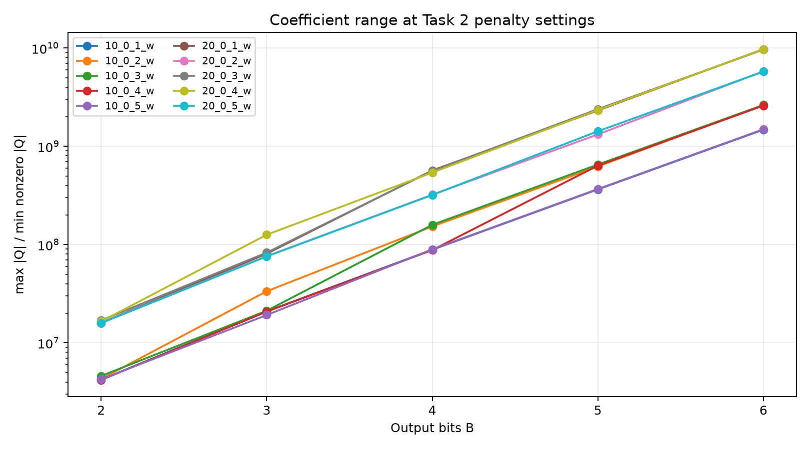

# Task 3: feasibility

All measurements use the committed OR-LIB data and `src/qubo.py` with linear encoding and slack penalties. The starting commit after the explicitly requested sync was `d12e80c`. Raw measurements, schedules and runtime metadata are in [`results/task3`](../results/task3/); the experiment code is [`experiments/feasibility.py`](../experiments/feasibility.py).

## Method and timing conditions

No solver hyperparameters were tuned. SCIP uses the repository’s fixed single-thread, zero-gap settings, feasibility tolerance 1e-8 and random seed shift 0. Each QUBO solve has a 600-second SCIP limit. Its binary variables are exactly the QUBO bits; continuous auxiliary variables lift affine output, squared residual/cost terms and binary products without imposing physical UC constraints. Thus infeasible schedules remain in the search space. This is an equivalent representation of the QUBO, not a constrained UC substitute. The returned bit string is independently evaluated with `QUBO.energy` and rational feasibility checks. Proven optimal means SCIP status `optimal`, zero gap, subject to floating-point solver tolerances, not a formal exact-arithmetic certificate.

Brute force is used when n ≤ 22; the requested proportional reductions all exceed that cutoff. A test compares the lifted SCIP model against exhaustive enumeration. The existing 2-unit/2-hour brute-force test, discretized-optimum energy checks and a computed four-cost telescoping check also pass.

Timing is wall time with `time.perf_counter`. Exact-QUBO timing includes model construction and optimization; the raw records also separate build and SCIP time. Heuristic timing includes the sampler call and its internal conversion, but excludes QUBO construction and post-run feasibility evaluation. The threshold, heuristic and size sweeps run sequentially; lightweight artifact inspection and validation can occur during a sweep. Wall times describe this shared cloud runtime. All coefficients and solver arithmetic use float64; decoded grid checks use exact rational arithmetic. Every timing record includes CPU, thread configuration, library versions and dtype. The five requested seeds override AGENTS.md’s general ten-seed rule.

Runtime metadata shared by the measurements (also embedded in every record):

```json
{
  "cpu_model": "AMD EPYC 9V45 96-Core Processor",
  "logical_cpu_count": 3,
  "scip_threads": 1,
  "python": "3.12.14",
  "libraries": {
    "numpy": "2.5.4",
    "scipy": "1.18.1",
    "pyscipopt": "6.3.0",
    "torch": "2.15.0+cpu",
    "dimod": "0.12.23",
    "dwave-samplers": "1.8.0",
    "simulated-bifurcation": "2.0.0",
    "matplotlib": "3.11.2",
    "pandas": "3.1.0"
  },
  "scip_version": "10.0.2",
  "parameters": {
    "limits/gap": 0.0,
    "limits/absgap": 0.0,
    "numerics/feastol": 1e-08,
    "parallel/maxnthreads": 1,
    "randomization/randomseedshift": 0
  },
  "dtype": "float64",
  "omp_threads": "2",
  "openblas_threads": "2"
}
```

The container CPU quota is 2 CPU equivalents (`cpu.max = 200000 100000`); logical CPU count is host visibility. OMP/OpenBLAS and PyTorch use 2 threads; SCIP uses 1. No GPU is used.

## Reduced data

For each hour, demand is computed with integer arithmetic as `ceil(D_full × kept_capacity / full_capacity)`, and asserted no larger than kept capacity. Unit order is the loader/raw-file order. Limits, fitted quadratic costs `(a,b,c)`, cheapest start-up costs, must-run flags and initial on/off states are unchanged. The audit field in each saved data JSON retains the source preprocessing log, including dropped minimum up/down times, ramp limits, reserves, network and extra start-up categories.

### 10_0_1_w_k3_T2

Demand (MW): `[185, 175]`. Full per-hour data: [`JSON`](../results/task3/10_0_1_w_k3_T2_data.json).

| Unit | Initially on | Pmin by hour | Pmax by hour | Start-up by hour | Must run | (a,b,c) by hour |
| --- | --- | --- | --- | --- | --- | --- |
| g0 | False | [32.0, 32.0] | [118.0, 118.0] | [172.862432, 172.862432] | [False, False] | [[1337.7735799999955, 43.16996199999992, 0.07698800000000078], [1337.7735799999955, 43.16996199999992, 0.07698800000000078]] |
| g1 | True | [37.0, 37.0] | [119.0, 119.0] | [168.685601, 168.685601] | [False, False] | [[1362.6560739999998, 45.08669599999985, 0.08929300000000132], [1362.6560739999998, 45.08669599999985, 0.08929300000000132]] |
| g2 | False | [48.0, 48.0] | [105.0, 105.0] | [162.202704, 162.202704] | [False, False] | [[1377.1167209999942, 40.46014199999998, 0.030422000000000494], [1377.1167209999942, 40.46014199999998, 0.030422000000000494]] |

### 10_0_1_w_k3_T4

Demand (MW): `[185, 175, 143, 142]`. Full per-hour data: [`JSON`](../results/task3/10_0_1_w_k3_T4_data.json).

| Unit | Initially on | Pmin by hour | Pmax by hour | Start-up by hour | Must run | (a,b,c) by hour |
| --- | --- | --- | --- | --- | --- | --- |
| g0 | False | [32.0, 32.0, 32.0, 32.0] | [118.0, 118.0, 118.0, 118.0] | [172.862432, 172.862432, 172.862432, 172.862432] | [False, False, False, False] | [[1337.7735799999955, 43.16996199999992, 0.07698800000000078], [1337.7735799999955, 43.16996199999992, 0.07698800000000078], [1337.7735799999955, 43.16996199999992, 0.07698800000000078], [1337.7735799999955, 43.16996199999992, 0.07698800000000078]] |
| g1 | True | [37.0, 37.0, 37.0, 37.0] | [119.0, 119.0, 119.0, 119.0] | [168.685601, 168.685601, 168.685601, 168.685601] | [False, False, False, False] | [[1362.6560739999998, 45.08669599999985, 0.08929300000000132], [1362.6560739999998, 45.08669599999985, 0.08929300000000132], [1362.6560739999998, 45.08669599999985, 0.08929300000000132], [1362.6560739999998, 45.08669599999985, 0.08929300000000132]] |
| g2 | False | [48.0, 48.0, 48.0, 48.0] | [105.0, 105.0, 105.0, 105.0] | [162.202704, 162.202704, 162.202704, 162.202704] | [False, False, False, False] | [[1377.1167209999942, 40.46014199999998, 0.030422000000000494], [1377.1167209999942, 40.46014199999998, 0.030422000000000494], [1377.1167209999942, 40.46014199999998, 0.030422000000000494], [1377.1167209999942, 40.46014199999998, 0.030422000000000494]] |

### 10_0_1_w_k4_T2

Demand (MW): `[246, 232]`. Full per-hour data: [`JSON`](../results/task3/10_0_1_w_k4_T2_data.json).

| Unit | Initially on | Pmin by hour | Pmax by hour | Start-up by hour | Must run | (a,b,c) by hour |
| --- | --- | --- | --- | --- | --- | --- |
| g0 | False | [32.0, 32.0] | [118.0, 118.0] | [172.862432, 172.862432] | [False, False] | [[1337.7735799999955, 43.16996199999992, 0.07698800000000078], [1337.7735799999955, 43.16996199999992, 0.07698800000000078]] |
| g1 | True | [37.0, 37.0] | [119.0, 119.0] | [168.685601, 168.685601] | [False, False] | [[1362.6560739999998, 45.08669599999985, 0.08929300000000132], [1362.6560739999998, 45.08669599999985, 0.08929300000000132]] |
| g2 | False | [48.0, 48.0] | [105.0, 105.0] | [162.202704, 162.202704] | [False, False] | [[1377.1167209999942, 40.46014199999998, 0.030422000000000494], [1377.1167209999942, 40.46014199999998, 0.030422000000000494]] |
| g3 | True | [48.0, 48.0] | [113.0, 113.0] | [160.219192, 160.219192] | [False, False] | [[1511.8219169999961, 49.00791399999993, 0.06160200000000076], [1511.8219169999961, 49.00791399999993, 0.06160200000000076]] |

### 10_0_1_w_k4_T4

Demand (MW): `[246, 232, 190, 188]`. Full per-hour data: [`JSON`](../results/task3/10_0_1_w_k4_T4_data.json).

| Unit | Initially on | Pmin by hour | Pmax by hour | Start-up by hour | Must run | (a,b,c) by hour |
| --- | --- | --- | --- | --- | --- | --- |
| g0 | False | [32.0, 32.0, 32.0, 32.0] | [118.0, 118.0, 118.0, 118.0] | [172.862432, 172.862432, 172.862432, 172.862432] | [False, False, False, False] | [[1337.7735799999955, 43.16996199999992, 0.07698800000000078], [1337.7735799999955, 43.16996199999992, 0.07698800000000078], [1337.7735799999955, 43.16996199999992, 0.07698800000000078], [1337.7735799999955, 43.16996199999992, 0.07698800000000078]] |
| g1 | True | [37.0, 37.0, 37.0, 37.0] | [119.0, 119.0, 119.0, 119.0] | [168.685601, 168.685601, 168.685601, 168.685601] | [False, False, False, False] | [[1362.6560739999998, 45.08669599999985, 0.08929300000000132], [1362.6560739999998, 45.08669599999985, 0.08929300000000132], [1362.6560739999998, 45.08669599999985, 0.08929300000000132], [1362.6560739999998, 45.08669599999985, 0.08929300000000132]] |
| g2 | False | [48.0, 48.0, 48.0, 48.0] | [105.0, 105.0, 105.0, 105.0] | [162.202704, 162.202704, 162.202704, 162.202704] | [False, False, False, False] | [[1377.1167209999942, 40.46014199999998, 0.030422000000000494], [1377.1167209999942, 40.46014199999998, 0.030422000000000494], [1377.1167209999942, 40.46014199999998, 0.030422000000000494], [1377.1167209999942, 40.46014199999998, 0.030422000000000494]] |
| g3 | True | [48.0, 48.0, 48.0, 48.0] | [113.0, 113.0, 113.0, 113.0] | [160.219192, 160.219192, 160.219192, 160.219192] | [False, False, False, False] | [[1511.8219169999961, 49.00791399999993, 0.06160200000000076], [1511.8219169999961, 49.00791399999993, 0.06160200000000076], [1511.8219169999961, 49.00791399999993, 0.06160200000000076], [1511.8219169999961, 49.00791399999993, 0.06160200000000076]] |

### 10_0_1_w_k5_T2

Demand (MW): `[301, 285]`. Full per-hour data: [`JSON`](../results/task3/10_0_1_w_k5_T2_data.json).

| Unit | Initially on | Pmin by hour | Pmax by hour | Start-up by hour | Must run | (a,b,c) by hour |
| --- | --- | --- | --- | --- | --- | --- |
| g0 | False | [32.0, 32.0] | [118.0, 118.0] | [172.862432, 172.862432] | [False, False] | [[1337.7735799999955, 43.16996199999992, 0.07698800000000078], [1337.7735799999955, 43.16996199999992, 0.07698800000000078]] |
| g1 | True | [37.0, 37.0] | [119.0, 119.0] | [168.685601, 168.685601] | [False, False] | [[1362.6560739999998, 45.08669599999985, 0.08929300000000132], [1362.6560739999998, 45.08669599999985, 0.08929300000000132]] |
| g2 | False | [48.0, 48.0] | [105.0, 105.0] | [162.202704, 162.202704] | [False, False] | [[1377.1167209999942, 40.46014199999998, 0.030422000000000494], [1377.1167209999942, 40.46014199999998, 0.030422000000000494]] |
| g3 | True | [48.0, 48.0] | [113.0, 113.0] | [160.219192, 160.219192] | [False, False] | [[1511.8219169999961, 49.00791399999993, 0.06160200000000076], [1511.8219169999961, 49.00791399999993, 0.06160200000000076]] |
| g4 | False | [47.0, 47.0] | [102.0, 102.0] | [159.160047, 159.160047] | [False, False] | [[1468.9589319999977, 45.54301799999995, 0.052430000000000546], [1468.9589319999977, 45.54301799999995, 0.052430000000000546]] |

### 10_0_1_w_k5_T4

Demand (MW): `[301, 285, 232, 230]`. Full per-hour data: [`JSON`](../results/task3/10_0_1_w_k5_T4_data.json).

| Unit | Initially on | Pmin by hour | Pmax by hour | Start-up by hour | Must run | (a,b,c) by hour |
| --- | --- | --- | --- | --- | --- | --- |
| g0 | False | [32.0, 32.0, 32.0, 32.0] | [118.0, 118.0, 118.0, 118.0] | [172.862432, 172.862432, 172.862432, 172.862432] | [False, False, False, False] | [[1337.7735799999955, 43.16996199999992, 0.07698800000000078], [1337.7735799999955, 43.16996199999992, 0.07698800000000078], [1337.7735799999955, 43.16996199999992, 0.07698800000000078], [1337.7735799999955, 43.16996199999992, 0.07698800000000078]] |
| g1 | True | [37.0, 37.0, 37.0, 37.0] | [119.0, 119.0, 119.0, 119.0] | [168.685601, 168.685601, 168.685601, 168.685601] | [False, False, False, False] | [[1362.6560739999998, 45.08669599999985, 0.08929300000000132], [1362.6560739999998, 45.08669599999985, 0.08929300000000132], [1362.6560739999998, 45.08669599999985, 0.08929300000000132], [1362.6560739999998, 45.08669599999985, 0.08929300000000132]] |
| g2 | False | [48.0, 48.0, 48.0, 48.0] | [105.0, 105.0, 105.0, 105.0] | [162.202704, 162.202704, 162.202704, 162.202704] | [False, False, False, False] | [[1377.1167209999942, 40.46014199999998, 0.030422000000000494], [1377.1167209999942, 40.46014199999998, 0.030422000000000494], [1377.1167209999942, 40.46014199999998, 0.030422000000000494], [1377.1167209999942, 40.46014199999998, 0.030422000000000494]] |
| g3 | True | [48.0, 48.0, 48.0, 48.0] | [113.0, 113.0, 113.0, 113.0] | [160.219192, 160.219192, 160.219192, 160.219192] | [False, False, False, False] | [[1511.8219169999961, 49.00791399999993, 0.06160200000000076], [1511.8219169999961, 49.00791399999993, 0.06160200000000076], [1511.8219169999961, 49.00791399999993, 0.06160200000000076], [1511.8219169999961, 49.00791399999993, 0.06160200000000076]] |
| g4 | False | [47.0, 47.0, 47.0, 47.0] | [102.0, 102.0, 102.0, 102.0] | [159.160047, 159.160047, 159.160047, 159.160047] | [False, False, False, False] | [[1468.9589319999977, 45.54301799999995, 0.052430000000000546], [1468.9589319999977, 45.54301799999995, 0.052430000000000546], [1468.9589319999977, 45.54301799999995, 0.052430000000000546], [1468.9589319999977, 45.54301799999995, 0.052430000000000546]] |

## Exact penalty thresholds

For each setting, solve the hard discrete model to proven optimality for z_disc. For λ₂, hold λ₁ = 10 max(a+S); start at zero and the Section 5 estimate, double the upper endpoint until the returned exact ground state is feasible and has true cost equal to z_disc (absolute tolerance 1e-5), then bisect until `(upper−lower)/upper ≤ 1%`. For λ₁, hold λ₂ at 10 times the certified feasible upper endpoint of its bracket and repeat. The lower endpoint fails this criterion and the upper endpoint passes. At an exact tie, feasible and infeasible minimizers may coexist; brackets approximate the transition/infimum and do not claim uniqueness or that every tied ground state is feasible. Zero is reported explicitly if it passes.

Δ_min is the smallest positive **unit-output** grid step, as in Task 2; it is not the much smaller common slack/aggregate lattice step. The comparison estimates are λ₂ = b_max/Δ_min and λ₁ = max(a+S). Brackets and every individual solve, including returned bits, are saved. An infeasible exact ground state has `infeasible_ground_state=true` and G_pen=NaN (blank in the CSV); infeasibility is never treated as an objective gap. All derived ground-state gaps and per-probe timings are in [`ground_states.csv`](../results/task3/ground_states.csv).

| k | T | B | n | z_disc | λ₂ bracket | λ₂ estimate | upper/estimate | λ₁ bracket | λ₁ estimate | upper/estimate | Failure |
| --- | --- | --- | --- | --- | --- | --- | --- | --- | --- | --- | --- |
| 3 | 2 | 2 | 36 | 22953.7644 | (10.085182, 10.1593377] | 2.372984 | 4.28125 | (865.867177, 871.880143] | 1539.31942 | 0.56640625 |  |
| 3 | 2 | 3 | 46 | 22572.4863 | (222.862747, 224.246988] | 5.53696267 | 40.5 | (775.672679, 781.685646] | 1539.31942 | 0.5078125 |  |
| 3 | 2 | 4 | 54 | 22522.9049 | (3678.1252, 3701.85504] | 11.86492 | 312 | (775.672679, 781.685646] | 1539.31942 | 0.5078125 |  |
| 3 | 2 | 5 | 62 | 22344.6867 | (5100.33361, 5149.37528] | 24.5208347 | 210 | (751.620813, 757.633779] | 1539.31942 | 0.4921875 |  |
| 3 | 4 | 2 | 74 | 41558.1815 | (207.6361, 208.822592] | 2.372984 | 88 | (1503.24163, 1515.26756] | 1539.31942 | 0.984375 |  |
| 3 | 4 | 3 | 92 | 41037.0543 | (340.523204, 343.291685] | 5.53696267 | 62 | (1334.87856, 1346.9045] | 1539.31942 | 0.875 |  |
| 3 | 4 | 4 | 108 | 40703.0086 | (3678.1252, 3701.85504] | 11.86492 | 312 | (1334.87856, 1346.9045] | 1539.31942 | 0.875 |  |
| 3 | 4 | 5 | 124 | 40451.27 | (5100.33361, 5149.37528] | 24.5208347 | 210 | (1334.87856, 1346.9045] | 1539.31942 | 0.875 |  |
| 4 | 2 | 2 | 44 | 32110.4379 | (1289.68195, 1299.9994] | 2.57936389 | 504 | (1685.10393, 1698.16675] | 1672.04111 | 1.015625 |  |
| 4 | 2 | 3 | 54 | 31100.7654 | (28.023714, 28.2117926] | 6.01851575 | 4.6875 | (1423.84751, 1436.91033] | 1672.04111 | 0.859375 |  |
| 4 | 2 | 4 | 64 | 31054.7836 | (457.837091, 461.061296] | 12.8968195 | 35.75 | (1371.59622, 1384.65904] | 1672.04111 | 0.828125 |  |
| 4 | 2 | 5 | 74 | 30981.0555 | (926.206585, 932.869942] | 26.6534269 | 35 | (1358.5334, 1371.59622] | 1672.04111 | 0.8203125 |  |
| 4 | 4 | 2 | 88 | 55676.3985 | (1341.26923, 1351.58668] | 2.57936389 | 524 | (1711.22957, 1724.29239] | 1672.04111 | 1.03125 |  |
| 4 | 4 | 3 | 108 | 54349.7062 | (91.0300508, 91.7823653] | 6.01851575 | 15.25 | (1423.84751, 1436.91033] | 1672.04111 | 0.859375 |  |
| 4 | 4 | 4 | 128 | 54092.403 | (457.837091, 461.061296] | 12.8968195 | 35.75 | (1371.59622, 1384.65904] | 1672.04111 | 0.828125 |  |
| 4 | 4 | 5 | 150 | 54052.1565 | (4237.89488, 4264.54831] | 26.6534269 | 160 | (1358.5334, 1371.59622] | 1672.04111 | 0.8203125 |  |
| 5 | 2 | 2 | 50 | 37738.1515 | (66.1606839, 66.8289736] | 2.67315895 | 25 | (979.711587, 986.242998] | 1672.04111 | 0.58984375 |  |
| 5 | 2 | 3 | 62 | 37290.4731 | (2145.65558, 2158.13032] | 6.23737087 | 346 | (836.020554, 842.551965] | 1672.04111 | 0.50390625 |  |
| 5 | 2 | 4 | 74 | 37069.5473 | (1697.45593, 1710.82173] | 13.3657947 | 128 | (757.643628, 764.175038] | 1672.04111 | 0.45703125 |  |
| 5 | 2 | 5 | 87 | 37009.2166 | (835.584934, 842.490594] | 27.6226424 | 30.5 | (724.986575, 731.517985] | 1672.04111 | 0.4375 |  |
| 5 | 4 | 2 | 100 | 68026.0284 | (1079.95621, 1090.64885] | 2.67315895 | 408 | (1397.72186, 1410.78469] | 1672.04111 | 0.84375 |  |
| 5 | 4 | 3 | 126 | 67153.0615 | (2145.65558, 2158.13032] | 6.23737087 | 346 | (1306.28212, 1319.34494] | 1672.04111 | 0.7890625 |  |
| 5 | 4 | 4 | 150 | 66887.0587 | (1697.45593, 1710.82173] | 13.3657947 | 128 | (1332.40776, 1345.47058] | 1672.04111 | 0.8046875 |  |
| 5 | 4 | 5 | 175 | 66761.8151 | (835.584934, 842.490594] | 27.6226424 | 30.5 | (1332.40776, 1345.47058] | 1672.04111 | 0.8046875 |  |

### Lower-endpoint witnesses

Signed supply − demand − slack residuals at the failing λ₂ endpoint explain why the unit-step estimate can miss the transition. Combinations of different unit grids can change aggregate supply by much less than Δ_min; a small residual incurs a squared penalty while changing which dispatch combination is cheapest. Adjacent full-range grids have denominators 3, 7, 15 and 31 and are not nested, so changing B also changes the attainable near-demand combinations. Start-up/no-load choices and quadratic fuel costs also lie outside the linear one-unit estimate. The rows below report computed witnesses rather than assuming a doubling law.

| k | T | B | Exact residuals (MW) | Off-output bit violations | z_disc − witness true cost |
| --- | --- | --- | --- | --- | --- |
| 3 | 2 | 2 | ['-22/3', '-17/3'] | 0 | 870.32765 |
| 3 | 2 | 3 | ['0', '-8/7'] | 0 | 292.786093 |
| 3 | 2 | 4 | ['-1/5', '0'] | 0 | 147.132772 |
| 3 | 2 | 5 | ['0', '-2/31'] | 0 | 21.2573852 |
| 3 | 4 | 2 | ['0', '0', '-1', '0'] | 0 | 207.851253 |
| 3 | 4 | 3 | ['0', '0', '0', '-6/7'] | 0 | 250.338525 |
| 3 | 4 | 4 | ['-1/5', '0', '0', '0'] | 0 | 147.132772 |
| 3 | 4 | 5 | ['0', '-2/31', '0', '0'] | 0 | 21.2573852 |
| 4 | 2 | 2 | ['0', '-2/3'] | 0 | 573.632313 |
| 4 | 2 | 3 | ['0', '-12/7'] | 0 | 82.6451886 |
| 4 | 2 | 4 | ['0', '-1/15'] | 0 | 2.04392158 |
| 4 | 2 | 5 | ['0', '-4/31'] | 0 | 15.4900102 |
| 4 | 4 | 2 | ['0', '-2/3', '0', '0'] | 0 | 600.547322 |
| 4 | 4 | 3 | ['0', '0', '0', '-13/7'] | 0 | 316.027042 |
| 4 | 4 | 4 | ['0', '-1/15', '0', '0'] | 0 | 2.04392158 |
| 4 | 4 | 5 | ['0', '0', '0', '-4/31'] | 0 | 70.7061464 |
| 5 | 2 | 2 | ['-7/3', '0'] | 0 | 361.915913 |
| 5 | 2 | 3 | ['0', '-2/7'] | 0 | 175.311944 |
| 5 | 2 | 4 | ['0', '-2/15'] | 0 | 30.3369229 |
| 5 | 2 | 5 | ['0', '-5/31'] | 0 | 21.8487722 |
| 5 | 4 | 2 | ['0', '0', '-2/3', '0'] | 0 | 480.2692 |
| 5 | 4 | 3 | ['0', '-2/7', '0', '0'] | 0 | 175.311944 |
| 5 | 4 | 4 | ['0', '-2/15', '0', '0'] | 0 | 30.3369229 |
| 5 | 4 | 5 | ['0', '-5/31', '0', '0'] | 0 | 21.8487722 |

### Scaling with bit depth

Fit `log(λ₂ upper) = intercept + slope × B` separately for each reduction; `exp(slope)` is the fitted multiplicative change per added bit. Adjacent ratios are also shown because a four-point exponential fit can hide lattice effects. The Section 5 asymptotic prediction is about 2× per added bit; its finite-B estimate ratios are 7/3, 15/7 and 31/15.

| k | T | Points | B3/B2 | B4/B3 | B5/B4 | Fitted ratio/bit | R² (log) |
| --- | --- | --- | --- | --- | --- | --- | --- |
| 3 | 2 | 4 | 22.0729927 | 16.5079365 | 1.39102564 | 8.57503739 | 0.914857985 |
| 3 | 4 | 4 | 1.64393939 | 10.7834101 | 1.39102564 | 3.31794155 | 0.902297084 |
| 4 | 2 | 4 | 0.0217013889 | 16.3428571 | 2.02331002 | 1.1970056 | 0.0177681787 |
| 4 | 4 | 4 | 0.0679071247 | 5.0234192 | 9.24941725 | 1.65885598 | 0.160101161 |
| 5 | 2 | 4 | 32.2933333 | 0.792733278 | 0.492447917 | 2.08974257 | 0.356778698 |
| 5 | 4 | 4 | 1.97875817 | 0.792733278 | 0.492447917 | 0.904225486 | 0.0931757963 |

A pooled log-linear fit with a separate intercept for each reduction gives **2.17803× per added bit** (within-reduction R²=0.310928). This averages strongly different and sometimes non-monotone responses.

The data do **not** support a consistent doubling rule over B=2–5: several adjacent thresholds decrease, and the fitted ratios range from 0.904225486 to 8.57503739. Low R² in several reductions makes a single exponential law a poor description.

Across these settings, λ₂ upper/estimate ranges from 4.2812 to 524; λ₁ upper/estimate ranges from 0.4375 to 1.0312. The λ₁ estimate is much closer to the measured thresholds.

Exact bisection probes completed: 595; proven optimal: 595. Total probe wall time: 3288.736 s. Per-probe timing and metadata are in the linked raw records.

## Full-instance heuristic trials

B=4, λ₁=2 max(a+S), λ₂=2 b_max/Δ_min. SA uses dwave-samplers, 100 reads, default schedule, seeds 0–4. SB uses 128 agents, default ballistic mode, 10,000 maximum steps, unheated, default early stopping (sampling period 50, convergence threshold 50), seeds 0–4, CPU float64. Every SB call temporarily sets PyTorch’s default dtype to float64 and restores it in `finally`. `best_only=False` only retains all final agents for feasibility measurement; `verbose=False` only suppresses progress bars. No feasibility repair, resampling or parameter changes are applied.

Feasibility means the decoded **physical schedule** satisfies on/off, limits, exact grid membership and demand. Slack bits need not be optimal for a physically feasible sample. The additional zero-penalty count requires physical feasibility and exact supply−demand−slack=0 in every hour. Best energy includes the QUBO offset; best feasible cost is minimized over feasible samples, independently of energy rank. Rates count all returned reads/agents, including duplicates. A blank cost/gap means **no sample was feasible**. Full z_disc values are the committed, proven-optimal Task 1 certificates, re-encoded and independently costed. These trials alone cannot prove a full QUBO ground state feasible, even if no energy below z_disc is found (the certification wording in the stage documents is insufficient for that conclusion).

| Instance | Solver | Seed | n | λ₁ | λ₂ | Wall s | Best energy | Feasible / total | Rate | Zero-penalty samples | Best feasible true cost | z_disc | Absolute gap | Gap % |
| --- | --- | --- | --- | --- | --- | --- | --- | --- | --- | --- | --- | --- | --- | --- |
| 10_0_1_w | SA | 0 | 1522 | 7048.0395 | 35.4124865 | 3.17490333 | 2203228.27 | 0/100 | 0 | 0 |  | 1895177.51 |  |  |
| 10_0_1_w | SA | 1 | 1522 | 7048.0395 | 35.4124865 | 3.19357092 | 2204477.14 | 0/100 | 0 | 0 |  | 1895177.51 |  |  |
| 10_0_1_w | SA | 2 | 1522 | 7048.0395 | 35.4124865 | 3.18076721 | 2196900.81 | 0/100 | 0 | 0 |  | 1895177.51 |  |  |
| 10_0_1_w | SA | 3 | 1522 | 7048.0395 | 35.4124865 | 3.22015636 | 2205323.39 | 0/100 | 0 | 0 |  | 1895177.51 |  |  |
| 10_0_1_w | SA | 4 | 1522 | 7048.0395 | 35.4124865 | 3.17543917 | 2217619.46 | 0/100 | 0 | 0 |  | 1895177.51 |  |  |
| 20_0_1_w | SA | 0 | 2759 | 8590.98689 | 37.7083079 | 9.12618647 | 3759676.48 | 0/100 | 0 | 0 |  | 2907325.14 |  |  |
| 20_0_1_w | SA | 1 | 2759 | 8590.98689 | 37.7083079 | 8.96364901 | 3745050.01 | 0/100 | 0 | 0 |  | 2907325.14 |  |  |
| 20_0_1_w | SA | 2 | 2759 | 8590.98689 | 37.7083079 | 9.00745226 | 3774625.99 | 0/100 | 0 | 0 |  | 2907325.14 |  |  |
| 20_0_1_w | SA | 3 | 2759 | 8590.98689 | 37.7083079 | 8.90203667 | 3738310.49 | 0/100 | 0 | 0 |  | 2907325.14 |  |  |
| 20_0_1_w | SA | 4 | 2759 | 8590.98689 | 37.7083079 | 8.92009497 | 3699397.1 | 0/100 | 0 | 0 |  | 2907325.14 |  |  |
| 10_0_1_w | SB | 0 | 1522 | 7048.0395 | 35.4124865 | 60.889782 | 246884211 | 0/128 | 0 | 0 |  | 1895177.51 |  |  |
| 10_0_1_w | SB | 1 | 1522 | 7048.0395 | 35.4124865 | 60.1216575 | 247507355 | 0/128 | 0 | 0 |  | 1895177.51 |  |  |
| 10_0_1_w | SB | 2 | 1522 | 7048.0395 | 35.4124865 | 60.6749403 | 247903839 | 2/128 | 0.015625 | 0 | 2869285.73 | 1895177.51 | 974108.217 | 51.3993127 |
| 10_0_1_w | SB | 3 | 1522 | 7048.0395 | 35.4124865 | 60.623313 | 248068082 | 0/128 | 0 | 0 |  | 1895177.51 |  |  |
| 10_0_1_w | SB | 4 | 1522 | 7048.0395 | 35.4124865 | 60.9099953 | 247139647 | 1/128 | 0.0078125 | 0 | 2873932.92 | 1895177.51 | 978755.401 | 51.6445237 |
| 20_0_1_w | SB | 0 | 2759 | 8590.98689 | 37.7083079 | 208.443659 | 1.78255556e+09 | 0/128 | 0 | 0 |  | 2907325.14 |  |  |
| 20_0_1_w | SB | 1 | 2759 | 8590.98689 | 37.7083079 | 208.572791 | 1.77796404e+09 | 0/128 | 0 | 0 |  | 2907325.14 |  |  |
| 20_0_1_w | SB | 2 | 2759 | 8590.98689 | 37.7083079 | 206.537195 | 1.77769182e+09 | 0/128 | 0 | 0 |  | 2907325.14 |  |  |
| 20_0_1_w | SB | 3 | 2759 | 8590.98689 | 37.7083079 | 207.77484 | 1.77465384e+09 | 0/128 | 0 | 0 |  | 2907325.14 |  |  |
| 20_0_1_w | SB | 4 | 2759 | 8590.98689 | 37.7083079 | 207.945259 | 1.77747483e+09 | 0/128 | 0 | 0 |  | 2907325.14 |  |  |

| Instance | Solver | Seeds | Mean wall s | Best energy across seeds | Feasible samples | Total samples | Best feasible cost |
| --- | --- | --- | --- | --- | --- | --- | --- |
| 10_0_1_w | SA | 5 | 3.1889674 | 2196900.81 | 0 | 500 |  |
| 10_0_1_w | SB | 5 | 60.6439376 | 246884211 | 3 | 640 | 2869285.73 |
| 20_0_1_w | SA | 5 | 8.98388388 | 3699397.1 | 0 | 500 |  |
| 20_0_1_w | SB | 5 | 207.854749 | 1.77465384e+09 | 0 | 640 |  |

10_0_1_w, SA: **no feasible sample** among 500 returned samples.

20_0_1_w, SA: **no feasible sample** among 500 returned samples.

20_0_1_w, SB: **no feasible sample** among 640 returned samples.

No returned sample had zero total QUBO penalty. Physical feasibility and exact satisfaction of the encoded slack equation are therefore distinct outcomes in these trials.

## Largest reduced QUBO within ten minutes

A fixed size ladder uses B=5 and Task 2 weights (10× both estimates): k=5 with T=4,6,8,12,16,20,24, then k=6,7,8,9 with T=24. Each keeps the same proportional-demand rule. Stop at the first solve not proven optimal within 600 wall seconds. This measures the largest success on this stated ladder, not a global size limit over all possible reductions or weights. If a run times out, its feasibility column describes only the incumbent, not a proven ground state. No solver settings are changed between attempts. The complete data for these additional reductions are saved under [`capacity_data`](../results/task3/capacity_data/).

| Instance | B | n | Wall s | SCIP s | Status | Gap (fraction) | Feasible |
| --- | --- | --- | --- | --- | --- | --- | --- |
| 10_0_1_w_k5_T4 | 5 | 175 | 21.4178606 | 21.412902 | optimal | 0 | False |
| 10_0_1_w_k5_T6 | 5 | 263 | 143.1341 | 143.12911 | optimal | 0 | False |
| 10_0_1_w_k5_T8 | 5 | 349 | 600.006518 | 600.000339 | timelimit | 0.00488988989 | False |

Largest on the ladder: **10_0_1_w_k5_T6, B=5, n=263, 143.134 s**.

SCIP emitted `Cannot set feasibility tolerance to small value 1e-11 without GMP - using 1e-10.` during the size sweep. No settings were changed in response. The configured model feasibility tolerance is 1e-8; this warning concerns SCIP’s internal request. The complete output is retained in [`capacity.log`](../results/task3/capacity.log).

## Coefficient range

Recomputed for all ten instances, B=2–6, with the Task 2 weights λ₁=10 max(a+S), λ₂=10 b_max/Δ_min. The plotted ratio is max/min absolute nonzero upper-triangular Q coefficient, including diagonal linear terms and excluding the constant offset.



Numeric minima, maxima and ratios: [`coefficients.json`](../results/task3/coefficients.json).

## Reproduction and validation

Use the environment pinned by `requirements.lock`. No dependencies were added.

```bash
export OMP_NUM_THREADS=2 OPENBLAS_NUM_THREADS=2 MPLCONFIGDIR=/tmp/task3-mpl
python -m pytest -q
python -m experiments.feasibility thresholds
python -m experiments.feasibility heuristic
python -m experiments.feasibility capacity
python -m experiments.feasibility coefficients
python -m experiments.feasibility diagnostics
python -m experiments.feasibility_report
```

The runner checkpoints every solve and resumes completed measurements. Use a fresh `results/task3` directory to rerun, rather than mixing measurements from different environments. Raw JSON contains hardware/library/dtype metadata for every timing. Heuristic bit strings are retained in compressed NumPy archives.

Threshold settings completed: 24/24. Unresolved thresholds: 0. Full heuristic trials recorded: 20/20. Missing or timed-out results are left blank, not estimated.

Final validation: **89 tests passed**. The artifact audits independently re-evaluate 96 threshold endpoints and all 2280 saved heuristic samples, including exact rational feasibility, energies and feasible costs.
